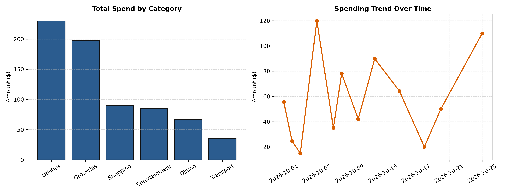

# Personal Expense & Spending Analytics Pipeline

A lightweight financial analytics tool built with Python, Pandas, NumPy, and Matplotlib. It ingests transactional CSV data, cleans and standardizes records, computes essential statistical metrics, and generates visual spending reports.

---

## Features
- **Data Ingestion & Cleaning:** Reads CSV transaction logs, normalizes datetime objects, and cleans bad numeric inputs using **Pandas**.
- **Statistical Aggregation:** Calculates total expenses, average transaction cost, and median spending using **NumPy**.
- **Spending by Category:** Aggregates and ranks categories to identify the biggest expenses.
- **Automated Visual Reporting:** Generates a dual-panel figure (category bar chart + chronological trend line) and exports it as a 300 DPI image (`expense_summary.png`) using **Matplotlib**.

---

## Tech Stack
- Python 3
- Pandas
- NumPy
- Matplotlib

---

## How to Run the Project

1. **Clone this repository:**
   ```bash
   git clone [https://github.com/](https://github.com/)<Shad21-u1>/expense-analyzer.git
   cd expense-analyzer
   ```

2. **Activate the virtual environment:**
   - On Windows:
     ```powershell
     .\venv\Scripts\Activate.ps1
     ```
   - On Mac/Linux:
     ```bash
     source venv/bin/activate
     ```

3. **Install dependencies:**
   ```bash
   pip install -r requirements.txt
   ```

4. **Run the pipeline:**
   ```bash
   python core.py
   ```

---

## Sample Visual Output

The script exports the analytical chart automatically:

